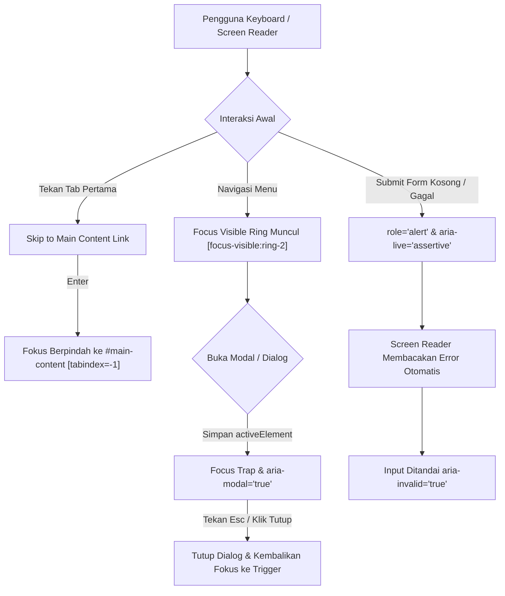

# Feature 25: Accessibility (a11y) Audit & Enhancements

> **Status**: ✅ Implemented (Stable)  
> **Standar Kepatuhan**: WCAG 2.1 / 2.2 Level AA  
> **Modul Terkait**: UI Shell, Layouts, Navigation, Forms, Media, Editor, Admin Console  
> **Lisensi**: MIT License  

---

## 1. Ringkasan & Motivasi

### Masalah yang Diselesaikan
Sebelum audit ini dilakukan, aplikasi editorial Blogku (`ncmaz-clone`) memiliki beberapa kesenjangan aksesibilitas mendasar:
1. **Focus Ring Hilang**: Terdapat 38+ kontrol tombol dan tautan yang menggunakan `focus:outline-none` tanpa pengganti `:focus-visible` ring. Pengguna keyboard tidak dapat melihat di mana letak fokus berada (melanggar WCAG 2.4.7 *Focus Visible* dan WCAG 1.4.11 *Non-text Contrast*).
2. **Ketiadaan Skip Links**: Pengguna pembaca layar (screen reader) dan keyboard harus melewati seluruh header, menu, dan navigasi setiap kali berpindah halaman sebelum mencapai konten utama (melanggar WCAG 2.4.1 *Bypass Blocks*).
3. **Sidebar Mobile Terjebak Tab Stop**: `AdminSidebar.vue` menyembunyikan sidebar di layar kecil hanya dengan translasi CSS (`-translate-x-full`), sehingga tautan navigasi off-screen tetap menjadi tab stop berurutan bagi pengguna keyboard.
4. **Pemberitahuan Error Form Tidak Terdengar**: Kesalahan input formulir (`LoginPage`, `ResetPasswordPage`, `NewsletterForm`, `CommentForm`, `ProfilePage`) dirender sebagai teks visual biasa tanpa `role="alert"` atau `aria-live="assertive"`, sehingga pengguna tuna netra tidak mendengar alasan submit gagal.
5. **Anti-pattern Aksesibilitas**: Tautan sosial di `AuthorSocialLinks.vue` menggunakan `role="listitem"` langsung pada tag `<a>`, yang merusak semantik tautan asli di browser/screen reader.
6. **Ambigu Kontrol Pengulang**: Tombol Edit, Delete, Play, dan Select Role di berbagai tabel dan kartu post menggunakan label generik yang identik tanpa nama objek konteks.

### Solusi yang Diimplementasikan
Audit menyeluruh berbasis panduan **Modern Web Guidance** (`accessibility` dan `accessible-error-announcement`) diterapkan pada 23 komponen dan halaman di seluruh workspace `frontend/src/`:
- Menambahkan **Skip to content** link pada `App.vue` (`#main-content`) dan `AdminLayout.vue` (`#admin-main`).
- Menggunakan atribut `:inert` pada `AdminSidebar.vue` mobile saat tertutup menggunakan `@vueuse/core` `useMediaQuery`.
- Menggantikan semua reset `focus:outline-none` dengan high-contrast `focus-visible:outline-none focus-visible:ring-2 focus-visible:ring-primary-500`.
- Memperbaiki pengumuman error formulir dengan `role="alert"`, `aria-live="assertive"`, `:aria-invalid`, dan `:aria-describedby`.
- Menyediakan `:aria-pressed` pada seluruh toggle button editor Tiptap (`EditorToolbar.vue`) dan playlist video (`VideoSection.vue`).
- Menambahkan dismiss <kbd>Escape</kbd> dan focus restoration pada seluruh modal dialog (`SearchDialog`, `PostPage` share dialog, `AdminTaxonomiesPage` dialogs, `AdminMediaLibraryPage` detail).
- Mengembalikan struktur semantik `<ul>` dan `<li>` pada `AuthorSocialLinks.vue` dan menambahkan teks eksplisit `(opens in new window)` pada tautan eksternal.

---

## 2. Arsitektur & Komponen

### Diagram Alur Aksesibilitas



### Komponen yang Dimodifikasi

| Layer / Kategori | File Komponen | Peningkatan Aksesibilitas |
| :--- | :--- | :--- |
| **Shell & Layouts** | `frontend/src/App.vue` | Skip to content link (`#main-content`, `tabindex="-1"` pada `<main>`). |
| | `frontend/src/layouts/AdminLayout.vue` | Skip to admin content link (`#admin-main`, `tabindex="-1"` pada `<main>`). |
| | `frontend/src/components/admin/AdminSidebar.vue` | Atribut `:inert="!open && !isLgScreen"` untuk mencegah tab stop tersembunyi, listener <kbd>Esc</kbd>, focus rings. |
| | `frontend/src/components/admin/AdminTopbar.vue` | `<span class="sr-only">has unread comments</span>` pada badge moderasi, focus rings pada link/avatar. |
| | `frontend/src/components/layout/AppHeader.vue` | `aria-expanded`, `aria-controls`, `aria-label="Search posts"`, <kbd>Esc</kbd> dismissal pada menu kategori. |
| | `frontend/src/components/layout/MobileNav.vue` | Landmark `id="mobile-nav"`, `aria-label="Mobile navigation"`, <kbd>Esc</kbd> key listener. |
| | `frontend/src/components/layout/UserMenu.vue` | `id="user-menu-button"`, `aria-controls`, `aria-label="User account menu"`, <kbd>Esc</kbd> key dismissal dan focus restoration. |
| | `frontend/src/components/layout/SearchDialog.vue` | Dialog focus preservation & restoration saat open/close, `aria-label="Search posts dialog"`. |
| | `frontend/src/components/layout/AppFooter.vue` | Semantic `<nav aria-label="...">`, teks bantu `(opens in new window)` pada tautan sosial. |
| | `frontend/src/components/layout/ToastHost.vue` | Focus visible styling pada tombol dismiss toast. |
| **Media & Content** | `frontend/src/components/sections/VideoSection.vue` | Dynamic `:title="activePost.title + ' video player'"`, `:aria-label="'Play video: ' + activePost.title"`, `:aria-pressed` pada playlist. |
| | `frontend/src/components/sections/PodcastSection.vue` | Menghilangkan click event non-keyboard pada wrapper div, play button disambiguated `:aria-label="... + post.title"`. |
| | `frontend/src/components/post/PostCard.vue` | `aria-hidden="true"` dan `tabindex="-1"` pada link thumbnail card (mencegah double title voiceover), audio button disambiguation. |
| | `frontend/src/components/post/PostActionDock.vue` | Penggantian reading progress button menjadi `<span role="status">` saat back-to-top tersembunyi. |
| | `frontend/src/components/sections/CategoriesSection.vue` | Scrollable carousel container diberi `role="region" aria-label="Trending categories carousel" tabindex="0"`. |
| **Formulir & Akun** | `frontend/src/pages/LoginPage.vue` | ARIA tablist/tab/tabpanel, panah kiri/kanan keyboard tab switching, error alert `role="alert" aria-live="assertive"`, `:aria-invalid`. |
| | `frontend/src/pages/ResetPasswordPage.vue` | `role="status"` pada kotak notifikasi sukses, `role="alert"` pada kotak pesan error. |
| | `frontend/src/components/comments/CommentForm.vue` | `role="alert"` pada error submit, `:aria-invalid="Boolean(error)"` dan `aria-describedby="comment-error"` pada `<textarea>`. |
| | `frontend/src/components/comments/CommentItem.vue` | `:aria-label="'Delete comment by ' + comment.author.name"`, focus visible pada tombol hapus. |
| | `frontend/src/pages/ProfilePage.vue` | `focus-within:ring-2` pada label upload file, `aria-label` pada URL inputs, `role="alert"` pada error password. |
| **Pages & Editor** | `frontend/src/pages/SearchPage.vue` | `aria-live="polite"` pada hasil pencarian counter text, `role="alert"` pada kotak pesan error pencarian. |
| | `frontend/src/pages/DashboardPage.vue` | Contextual `:aria-label="'Edit post: ' + post.title"` dan `:aria-label="'Delete post: ' + post.title"`, focus rings. |
| | `frontend/src/pages/AuthorPage.vue` | Follow button `:aria-pressed="followed"`, tablist role pada tab profil, `aria-label="Sort posts by"` pada select input. |
| | `frontend/src/components/editor/EditorToolbar.vue` | `:aria-pressed` pada semua formatting button (Heading, Bold, Italic, Strike, Code, List, Quote, Link, Align). |
| | `frontend/src/pages/PostPage.vue` | Focus restoration saat share modal ditutup, `aria-labelledby`, `(opens in new window)` pada tautan share media sosial. |
| **Admin Console** | `frontend/src/pages/admin/AdminUsersPage.vue` | `<caption class="sr-only">User and Role Management List</caption>`, `:aria-label="'Change role for ' + user.name"` pada select role. |
| | `frontend/src/pages/admin/AdminModerationPage.vue` | Disambiguated delete button `:aria-label="'Delete comment from ' + comment.author.name"`. |
| | `frontend/src/pages/admin/AdminTaxonomiesPage.vue` | `aria-labelledby` dan <kbd>Esc</kbd> dismissal pada 4 modal dialog, table caption, contextual aria-label pada edit/delete. |
| | `frontend/src/pages/admin/AdminMediaLibraryPage.vue` | Mengganti non-semantic `<div role="button">` dengan semantic `<button type="button">`, memisahkan tombol aksi overlay agar tidak bertumpuk secara ilegal. |

---

## 3. Kontrak Data & TypeScript Types

Tidak ada perubahan pada API backend atau skema basis data (`DataSource` contract tetap 100% kompatibel). Perubahan murni pada atribut ARIA, semantik HTML, dan reaktifitas UI.

### Pola Atribut Aksesibilitas Komponen
```typescript
interface AccessibleFormState {
  error: string
  isInvalid: boolean
  describedBy?: string
}

interface AccessibleModalProps {
  dialogTitleId: string
  onClose: () => void
  previousActiveElement: HTMLElement | null
}
```

---

## 4. Otorisasi & Keamanan

1. **DOMPurify Sanitization**: Seluruh konten kaya tetap dibersihkan menggunakan `sanitizeHtml` (`DOMPurify`) tanpa bypass atau evaluasi string dinamis (`eval`, `new Function`).
2. **Admin Lockdown**: Seluruh peningkatan aksesibilitas di area `/admin/*` tetap mematuhi proteksi role `adminOnly: true` pada router vue.
3. **External Link Security**: Semua tautan eksternal yang membuka tab baru selalu menyertakan `target="_blank" rel="noopener noreferrer"`.

---

## 5. Panduan Penggunaan (UI/UX)

### 1. Navigasi Keyboard
- **Tekan <kbd>Tab</kbd> pada awal load halaman**: Skip link muncul di pojok kiri atas (*Skip to main content*). Menekan <kbd>Enter</kbd> langsung memindahkan fokus browser ke elemen `<main>` tanpa perlu melewati seluruh menu header.
- **Navigasi Tab Login / Register**: Gunakan tombol panah <kbd>←</kbd> dan <kbd>→</kbd> untuk beralih antara formulir Log in dan Sign up.
- **Menutup Dialog / Dropdown**: Menekan tombol <kbd>Esc</kbd> pada modal share, dialog pencarian, popover emoji, menu kategori, atau dropdown user akan menutup dialog dan mengembalikan fokus keyboard ke tombol pemicunya (*focus restoration*).

### 2. Pengguna Screen Reader
- **Pengumuman Error Otomatis**: Saat formulir login, pendaftaran, komentar, atau ganti kata sandi mengalami galat validasi, pesan kesalahan akan otomatis dibacakan oleh pembaca layar melalui `aria-live="assertive" role="alert"`.
- **Status Tombol Toggle**: Di editor artikel, tombol format (Bold, Italic, Heading, List) akan mengumumkan status `pressed` atau `not pressed` sesuai posisi kursor pengguna di teks editor.

---

## 6. Pengujian & Verifikasi

### Checklist Verifikasi Kualitas
- [x] `vue-tsc --noEmit` (TypeScript strict mode) lulus dengan **0 errors**.
- [x] `eslint .` (ESLint) lulus bersih dengan **0 errors**.
- [x] `vitest run` (Unit & Component Test Suite) lulus **25 file / 233 passed**.
- [x] `npm run build` (Production Build Vite 8) berhasil menghasilkan bundel produksi bersih dalam 2.72s.
- [x] Manual keyboard navigation check: tab order berurutan, focus visible ring kontras tinggi, modal trapping & dismissal via <kbd>Esc</kbd> berjalan sesuai standar WCAG AA.
